# Lời nói đầu {-}

Nhóm 07 thực hiện đề tài *Xây dựng hệ cơ sở dữ liệu lưu trữ và tìm kiếm tiếng nhạc cụ bộ gõ*. Báo cáo này trình bày kết quả của Yêu cầu 3 và 4, tiếp nối báo cáo Yêu cầu 1–2 đã nộp. Bản trước gồm Phần I (bộ dữ liệu 655 tệp âm thanh thuộc 13 nhóm nhạc cụ bộ gõ) và Phần II (ba bộ đặc trưng A, B, C dùng để nhận diện và tìm kiếm âm thanh tương đồng).

Phần III trình bày công cụ trích rút đặc trưng và hệ cơ sở dữ liệu PostgreSQL quản lý đặc trưng của toàn bộ 655 tệp. Phần IV trình bày hệ thống tìm 5 tệp tương đồng nhất với một tệp âm thanh mới: sơ đồ khối, kết quả trung gian của quá trình truy vấn và đánh giá.

Để thống nhất với bản trước, báo cáo giữ cách đánh số tiếp theo: Mục 1–13, Bảng 1–11 và Hình 1–2 thuộc báo cáo Yêu cầu 1–2. Khi báo cáo này nhắc tới các mục, bảng đó, người đọc có thể tra trong bản đã nộp.

Nhóm xin chân thành cảm ơn TS. Nguyễn Đình Hóa đã hướng dẫn nhóm trong suốt học phần. Do thời gian và kiến thức còn hạn chế, báo cáo khó tránh khỏi thiếu sót. Nhóm rất mong nhận được góp ý để hoàn thiện đề tài.

{>}*Hà Nội, tháng 11 năm 2026*

{>}**Nhóm 07**

# Đề bài {-}

**Xây dựng hệ CSDL lưu trữ và tìm kiếm tiếng nhạc cụ bộ gõ.**
1. Hãy xây dựng/sưu tầm một bộ dữ liệu âm thanh gồm ít nhất 500 files âm thanh của các nhạc cụ khác nhau thuộc bộ gõ. Các file âm thanh có độ dài phù hợp để chứa đựng đủ các đặc tính cần thiết để nhận diện tiếng nhạc cụ. Mỗi file âm thanh chỉ gồm tiếng của một nhạc cụ. Sinh viên tùy chọn định dạng file âm thanh để lưu trữ. Hãy mô tả các đặc điểm giống và khác nhau của tiếng các nhạc cụ trong các files trong bộ dữ liệu.
1. Hãy xây dựng một hoặc vài bộ đặc trưng để nhận diện âm thanh các nhạc cụ từ bộ dữ liệu đã thu thập. Các bộ thuộc tính phải bao gồm các đặc trưng giúp tìm sự tương đồng và tìm sự khác biệt giữa các âm thanh nhạc cụ trong các files dữ liệu. Hãy trình bày rõ về các đặc trưng đó và nêu giá trị thông tin của các đặc trưng được sử dụng.
1. Triển khai các thuật toán/công cụ trích rút các đặc trưng đã được xác định trong bước 2. Hãy xây dựng hệ CSDL để quản trị các đặc trưng âm thanh cho tất cả các files dữ liệu.
1. Triển khai hệ thống tìm kiếm âm thanh tương đồng với đầu vào là một file âm thanh mới về một nhạc cụ nào đó thuộc bộ gõ (nhạc cụ thuộc loại đã có và không có trong dữ liệu), đầu ra là 5 files âm thanh giống nhất, xếp thứ tự giảm dần về độ tương đồng nội dung với âm thanh đầu vào.
   1. Trình bày sơ đồ khối của hệ thống, chức năng của từng khối/module của hệ thống cùng các dữ liệu vào/ra cho từng khối. Mô tả quy trình thực hiện yêu cầu của đề bài.
   1. Hãy minh họa các kết quả trung gian (các giá trị đặc trưng, tính toán độ tương đồng) của quá trình truy vấn âm thanh.
   1. Đánh giá các kết quả đã đạt được.
1. Demo hệ thống.


# Trích rút đặc trưng và hệ cơ sở dữ liệu

Phần này trình bày công cụ trích rút các đặc trưng đã xác định ở Phần II và hệ cơ sở dữ liệu quản trị đặc trưng của 655 tệp.

## Công cụ trích rút đặc trưng {#sec:congcu}

Công cụ viết bằng Python 3, dùng NumPy và SciPy để tính toán, SoundFile (thư viện libsndfile) để đọc tệp âm thanh. Thuật toán ở Mục 6–9 chỉ có một bản cài đặt, dùng chung lúc xây dựng cơ sở dữ liệu và lúc xử lý truy vấn, nên đặc trưng của tệp trong kho và của tệp truy vấn tính theo cùng định nghĩa, cùng tham số.

### Các bước xử lý một tệp âm thanh {#sec:buocxuly}

Mỗi tệp, dù trong kho hay là truy vấn, đi qua cùng sáu bước:
1. **Đọc tệp** ở các định dạng libsndfile hỗ trợ (WAV, FLAC, OGG, MP3…) thành ma trận mẫu số thực 64 bit kèm tần số lấy mẫu $f_s$. Tệp không đọc được bị từ chối.
1. **Kiểm tra tín hiệu** trên mẫu gốc theo sáu điều kiện ở Bảng @tab:kiemtra (Mục @sec:kiemtratinhieu).
1. **Đưa về một kênh, 16 kHz:** trộn các kênh bằng trung bình cộng; nếu $f_s\ne16.000$ Hz thì lấy mẫu lại bằng bộ lọc đa pha của SciPy. Các tệp trong kho đã ở dạng này.
1. **Tính mã băm PCM:** SHA-256 của tín hiệu đã lượng tử về số nguyên 16 bit, dùng để nhận ra truy vấn trùng một tệp trong kho.
1. **Trích đặc trưng** theo Mục 6 với thiết lập ở Bảng 6, được 21 giá trị gốc $a$ của bộ A và 39 giá trị gốc $b$ của bộ B.
1. **Chuẩn hóa** $z_j=(x_j-\mu_j)/s_j$ bằng 60 cặp tham số lưu trong cơ sở dữ liệu, rồi ghép thành $u_A$, $u_B$, $u_C$ (Mục 10.1). Riêng tệp truy vấn thì dùng $\mu_j, s_j$ đã lưu, không tính lại.

### Kiểm tra tín hiệu {#sec:kiemtratinhieu}

Bước 2 đo sáu đại lượng ở Bảng @tab:kiemtra theo đúng định nghĩa đã dùng khi tuyển chọn bộ dữ liệu (Mục 2), và cả 655 tệp trong kho đều đạt. Tệp rỗng, có mẫu NaN hoặc vô hạn, không đạt ít nhất một điều kiện trong bảng, hoặc sau chuẩn hóa đỉnh không có khối 10 ms nào có RMS lớn hơn 0,01 thì bị từ chối; thông báo liệt kê mọi điều kiện không đạt kèm số đo, ví dụ “đỉnh $-48{,}0$ dBFS $<-40$ dBFS”. Tệp có tín hiệu nhưng không có khung phổ hợp lệ thì xử lý như ở Mục 10.3.

Bảng: Các đại lượng kiểm tra tín hiệu {#tab:kiemtra}
| Đại lượng | Định nghĩa | Điều kiện |
|---|---|---|
| Thời lượng | Số mẫu chia tần số lấy mẫu | $\ge 0{,}1$ s |
| Thời gian có tiếng | Tổng thời lượng các khối 10 ms có RMS lớn hơn $\max(-70\ \text{dBFS};\ 1\%\ \text{đỉnh})$ | $\ge 0{,}05$ s |
| Biên độ đỉnh | Biên độ lớn nhất của tín hiệu, tính theo dBFS | $\ge -40$ |
| Mức mẫu đầu | Biên độ mẫu đầu tiên so với biên độ đỉnh | $\le 0{,}1$ |
| Mức phần cuối | RMS của khối 10 ms cuối cùng so với biên độ đỉnh | $\le 0{,}3$ |
| Tỷ lệ cắt đỉnh | Tỷ lệ mẫu có $|x|\ge0{,}999$ | $\le 0{,}01$ |

### Kiểm chứng giá trị trích rút

Giá trị gốc của 60 thuộc tính A, B và vector $u_C$ trong cơ sở dữ liệu trùng các bảng đặc trưng dùng ở Phần II (sai số lớn nhất bằng 0); thời lượng và SHA-256 của từng tệp khớp bảng kiểm kê. Chuyển một tệp trong kho sang hai kênh, 44,1 kHz rồi dùng làm truy vấn thì hệ thống vẫn tìm lại đúng tệp gốc ở hạng 1.

## Hệ cơ sở dữ liệu đặc trưng {#sec:csdl}

### Hệ quản trị

Nhóm dùng PostgreSQL 17.6 với phần mở rộng pgvector 0.8.0, chạy trong Docker. Dữ liệu mô tả và tham số chuẩn hóa có cấu trúc bảng, nên đặt trong hệ quản trị quan hệ để dùng khóa, ràng buộc và giao dịch giữ toàn vẹn dữ liệu. Vector đặc trưng lưu bằng kiểu `vector(n)` của pgvector; toán tử `<->` là khoảng cách Euclid, trùng với $d_S$ ở Mục 10, nên phép tìm 5 tệp gần nhất viết được bằng một câu lệnh SQL và có thể dùng chỉ mục HNSW khi kho lớn.

### Lược đồ {#sec:luocdo}

Lược đồ gồm sáu bảng (Hình @fig:luocdo, Bảng @tab:bang). Dữ liệu của mỗi tệp được tách thành bốn bảng theo vai trò, cùng khóa `file_id` và quan hệ 1–1: thông tin mô tả (`audio_files`), số đo kiểm tra tín hiệu (`signal_checks`), giá trị đặc trưng gốc (`raw_features`) và vector đã chuẩn hóa (`feature_vectors`). Tham số chuẩn hóa thuộc về cả kho nên nằm ở bảng riêng `normalization_params`; `db_info` ghi thông tin về cơ sở dữ liệu. Hình @fig:luocdo chỉ vẽ 5 trong 60 cột của `raw_features`; Visual Paradigm không có kiểu `vector` nên ghi các cột vector là blob.

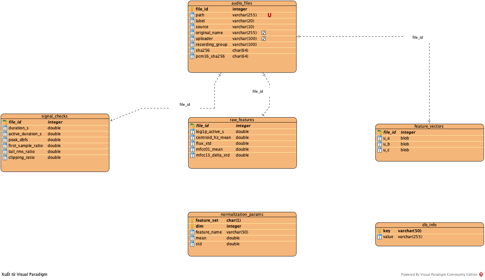

Bảng: Các bảng trong cơ sở dữ liệu {#tab:bang}
| Bảng | Số dòng | Nội dung |
|---|---|---|
| `audio_files` | 655 | Bảng danh mục (Mục 1.3): mã tệp, đường dẫn, nhãn, nguồn, tên gốc, người tải lên, nhóm bản thu, SHA-256 của tệp và của chuỗi mẫu PCM 16-bit. |
| `signal_checks` | 655 | Sáu số đo ở Bảng @tab:kiemtra. |
| `raw_features` | 655 | Giá trị gốc của 21 thuộc tính A và 39 thuộc tính B, kiểu `DOUBLE PRECISION`, cột đặt theo tên thuộc tính và thứ tự ở Phụ lục. |
| `normalization_params` | 60 | $\mu_j$, $s_j$ của 60 thuộc tính, tính một lần trên 655 tệp (Mục 10.1). |
| `feature_vectors` | 655 | $u_A$, $u_B$, $u_C$ lưu sẵn để tìm kiếm. |
| `db_info` | 6 | Phiên bản dữ liệu, thời điểm tạo, số tệp, số lớp, số chiều, phiên bản thư viện. |

Cơ sở dữ liệu lưu cả giá trị gốc lẫn vector đã chuẩn hóa. Giá trị gốc là dữ liệu chuẩn: khi đổi cách chuẩn hóa hay trọng số của C thì chỉ cần tính lại `feature_vectors`, không phải trích đặc trưng lại từ tệp âm thanh; còn `feature_vectors` có sẵn để câu lệnh SQL so sánh trực tiếp trên cột vector. Nhãn nhạc cụ chỉ nằm trong `audio_files`, không có trong các bảng đặc trưng, nên phép tìm kiếm chỉ dựa vào âm thanh; nhãn dùng để hiển thị và đánh giá.

### Ràng buộc toàn vẹn và chỉ mục

- **Khóa:** `file_id` là khóa chính của bốn bảng theo tệp; ba bảng phụ tham chiếu `audio_files` bằng khóa ngoại. `path` là duy nhất. Khóa chính của `normalization_params` là cặp (`feature_set`, `dim`).
- **Ràng buộc `CHECK`:** các cột của `signal_checks` đặt đúng các ngưỡng ở Bảng @tab:kiemtra, nên hệ quản trị không nhận tệp không đạt điều kiện chất lượng; ngoài ra $s_j>0$, `source` và `feature_set` chỉ nhận các giá trị hợp lệ.
- **Chỉ mục:** B-tree trên `label` và `pcm16_sha256` (nhận ra truy vấn trùng tệp bằng một phép tra cứu); HNSW trên `u_a`, `u_b`, `u_c` theo khoảng cách Euclid (Mục @sec:cachtim).

### Ví dụ dữ liệu của một tệp

Xét tệp kick mã 217 (Freesound, tên gốc “Kick Fx - Marker #183.wav”). Trong `signal_checks`, tệp dài 0,451 s, đỉnh $-1{,}90$ dBFS, mẫu đầu bằng 4,9% đỉnh và không có mẫu bị cắt đỉnh. Bảng @tab:vidu217 theo dõi năm thuộc tính của tệp qua ba bảng đặc trưng.

Bảng: Dữ liệu đặc trưng của tệp 217 {#tab:vidu217}
| Chiều | Thuộc tính | $x$ | $\mu$ | Độ tương đồng *s* | $z$ | $u_C$ |
|---|---|---|---|---|---|---|
| A1 | Thời gian có tín hiệu (log) | 0,372 | 0,476 | 0,459 | $-0{,}226$ | $-0{,}0349$ |
| A6 | TB trọng tâm phổ (Hz) | 65,8 | 1530,6 | 1698,3 | $-0{,}862$ | $-0{,}1331$ |
| A18 | TB tỷ lệ năng lượng dưới 500 Hz | 1,000 | 0,535 | 0,416 | 1,117 | 0,1723 |
| B1 | TB MFCC 1 | 29,86 | 9,66 | 12,78 | 1,580 | 0,1789 |
| B27 | ĐLC delta MFCC 1 | 0,728 | 0,651 | 0,362 | 0,214 | 0,0242 |

Thuộc tính bộ A có $u_C=z/\sqrt{42}$, bộ B có $u_C=z/\sqrt{78}$. Chẳng hạn ở A6, $z=(65{,}8-1530{,}6)/1698{,}3=-0{,}862$ và $u_C=-0{,}862/\sqrt{42}=-0{,}1331$, đúng giá trị lưu trong cột `u_c`. Trọng tâm phổ 65,8 Hz và gần 100% năng lượng dưới 500 Hz là đặc điểm điển hình của kick (Bảng 5).

## Xây dựng và truy vấn cơ sở dữ liệu {#sec:xaydung}

### Quy trình xây dựng {#sec:quytrinhxd}

1. **Đọc danh sách tệp** từ bảng kiểm kê và bảng danh mục nguồn; dừng nếu tập tệp WAV thực có khác hai bảng này.
1. **Gán nhóm bản thu**, gom các tệp có thể đến từ cùng một buổi thu: cùng người tải lên (Freesound), cùng bộ trống (IDMT), cùng nhạc cụ, cách đánh và độ to (Iowa). Kết quả có 136 nhóm, dùng khi đánh giá ở Mục @sec:danhgia.
1. **Trích đặc trưng từng tệp** bằng bước 1–5 ở Mục @sec:buocxuly.
1. **Tính tham số chuẩn hóa** $\mu_j$, $s_j$ trên 655 tệp, rồi tính $u_A$, $u_B$, $u_C$ cho từng tệp.
1. **Ghi vào cơ sở dữ liệu** trong một giao dịch: tạo lại sáu bảng, ghi dữ liệu và tạo chỉ mục. Lỗi ở bất kỳ bước nào làm giao dịch bị hủy, cơ sở dữ liệu giữ nguyên trạng thái cũ.
Toàn bộ quá trình mất khoảng 2–3 giây; cơ sở dữ liệu chiếm khoảng 11 MB.

### Truy vấn đặc trưng

Câu lệnh tìm 5 tệp gần nhất theo bộ C, loại các tệp trùng truy vấn (`:q` là vector $u_C$ của truy vấn, `:excluded` là danh sách mã tệp trùng):
```
SELECT t.file_id, t.label, v.u_c <-> :q AS d
FROM feature_vectors v JOIN audio_files t USING (file_id)
WHERE v.file_id <> ALL(:excluded) ORDER BY v.u_c <-> :q LIMIT 5;
```
Danh sách `:excluded` lấy từ câu `SELECT file_id FROM audio_files WHERE pcm16_sha256 = :pcm_hash`.

pgvector lưu mỗi thành phần vector bằng số thực 32 bit, lệch dưới $10^{-6}$ so với giá trị 64 bit mà Bảng 6 quy định. Vì vậy PostgreSQL chỉ chọn ra 10 ứng viên theo cột vector; chương trình tính lại khoảng cách của 10 ứng viên này bằng số thực 64 bit từ `raw_features` và `normalization_params` rồi lấy 5 tệp đầu, tệp nào cách đều truy vấn thì tệp có mã nhỏ hơn đứng trước. Kết quả trùng với phép tính 64 bit trên toàn kho (Mục @sec:dungdan).

# Tìm kiếm âm thanh tương đồng

## Sơ đồ khối và quy trình {#sec:sodokhoi}

### Sơ đồ khối

Hệ thống gồm hai luồng (Hình @fig:sodokhoi). Luồng xây dựng chạy một lần để đưa 655 tệp vào cơ sở dữ liệu (Phần III). Luồng truy vấn chạy với mỗi tệp âm thanh mới; hai luồng dùng chung các khối M2, M3, M4 và tham số chuẩn hóa $\mu_j, s_j$ lưu trong cơ sở dữ liệu.

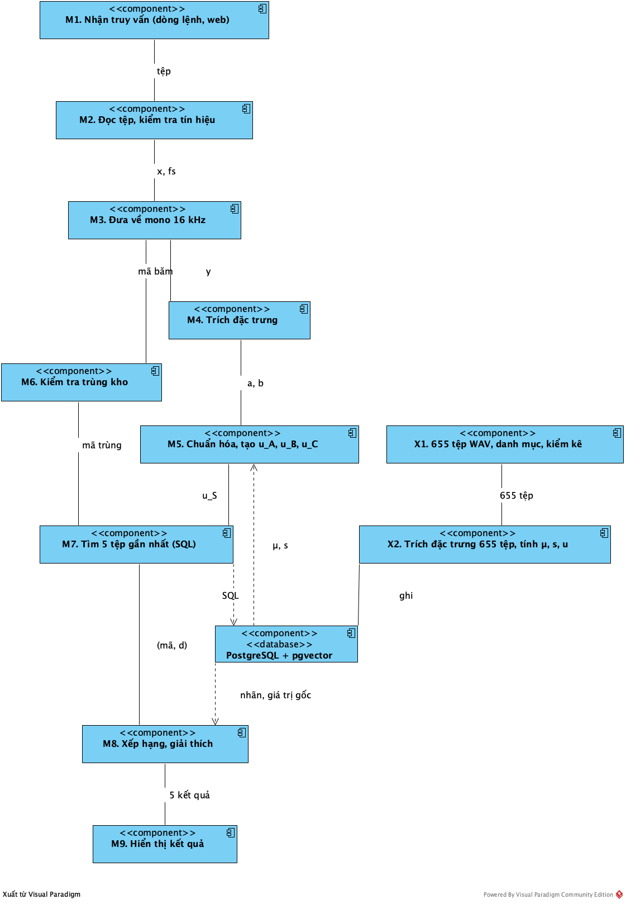

### Chức năng và dữ liệu vào, ra của từng khối

Bảng @tab:khoi mô tả chức năng, dữ liệu vào và dữ liệu ra của từng khối trong Hình @fig:sodokhoi. Các khối M2–M5 cài đặt đúng các bước 1–7 của Mục 6; khối M7 là bước 8.

Bảng: Chức năng và dữ liệu vào, ra của các khối {#tab:khoi}
| Khối | Chức năng | Đầu vào | Đầu ra |
|---|---|---|---|
| M1. Nhận truy vấn | Nhận tệp từ dòng lệnh hoặc trang web; chọn bộ đặc trưng (mặc định C) | Tệp WAV, MP3, FLAC, OGG, AIFF…; bộ $S$ | Đường dẫn tệp, $S$ |
| M2. Đọc và kiểm tra | Đọc mẫu số thực 64 bit; đo sáu đại lượng ở Bảng @tab:kiemtra | Tệp âm thanh | Ma trận mẫu $x$ (mẫu $\times$ kênh), $f_s$, sáu số đo; hoặc thông báo từ chối |
| M3. Chuẩn hóa định dạng | Trộn kênh bằng trung bình; lấy mẫu lại về 16 kHz; tính SHA-256 của PCM 16-bit | $x$, $f_s$ | Tín hiệu mono $y$; mã băm PCM |
| M4. Trích đặc trưng | Bước 2–6 của Mục 6 với thiết lập ở Bảng 6 | $y$ | $a\in\mathbb R^{21}$, $b\in\mathbb R^{39}$ |
| M5. Chuẩn hóa | Bước 7: $z_j=(x_j-\mu_j)/s_j$ với $\mu_j, s_j$ đọc từ cơ sở dữ liệu; tạo $u_A,u_B,u_C$ | $a$, $b$, $\mu$, *s* | $z\in\mathbb R^{60}$; $u_S$ |
| M6. Kiểm tra trùng | Tìm tệp trong kho có cùng mã băm PCM | Mã băm | Danh sách mã tệp cần loại |
| M7. Tìm kiếm | Bước 8: câu lệnh SQL `ORDER BY u <-> q LIMIT 10`; tính lại $d_S$ bằng số thực 64 bit, lấy 5 tệp | $u_S$, mã cần loại | 5 cặp (mã tệp, $d_S$) tăng dần |
| M8. Xếp hạng | Tính $s=1/(1+d)$; lấy nhãn, đường dẫn; tính $d_A,d_B,d_C$ và các thuộc tính A giống, khác nhất theo $|\Delta z|$ | 5 cặp (mã, $d$); danh mục tệp và giá trị đặc trưng gốc | 5 kết quả xếp theo độ tương đồng giảm dần |
| M9. Hiển thị | In ra màn hình, xuất JSON hoặc hiển thị trên web kèm trình phát âm thanh | 5 kết quả, số liệu trung gian | Kết quả cho người dùng |
| X1, X2. Xây dựng | Chạy M2–M4 cho 655 tệp; tính $\mu,s,u$; ghi vào cơ sở dữ liệu | 655 tệp, bảng danh mục và kiểm kê | Sáu bảng ở Bảng @tab:bang |

### Quy trình thực hiện một truy vấn

1. Người dùng đưa vào một tệp âm thanh và chọn bộ đặc trưng (mặc định C).
1. M2 kiểm tra tín hiệu. Tệp không đạt điều kiện Mục 2 bị từ chối và quá trình dừng.
1. M3 đưa tín hiệu về mono 16 kHz; M6 dùng mã băm PCM để nhận ra truy vấn trùng một tệp trong kho.
1. M4 tính 21 giá trị A và 39 giá trị B; M5 chuẩn hóa bằng $\mu_j, s_j$ đã lưu, không tính lại trên truy vấn.
1. M7 gửi câu lệnh SQL đến PostgreSQL, nhận 10 ứng viên, tính lại khoảng cách và giữ 5 tệp gần nhất, đã loại tệp trùng.
1. M8 tính độ tương đồng $s=1/(1+d)$, xếp giảm dần và kèm phần giải thích; M9 trả kết quả.
Với nhạc cụ chưa có trong kho, quy trình vẫn như trên và hệ thống trả 5 tệp có đặc trưng gần nhất. Hình @fig:hoatdong là sơ đồ hoạt động của quy trình này.

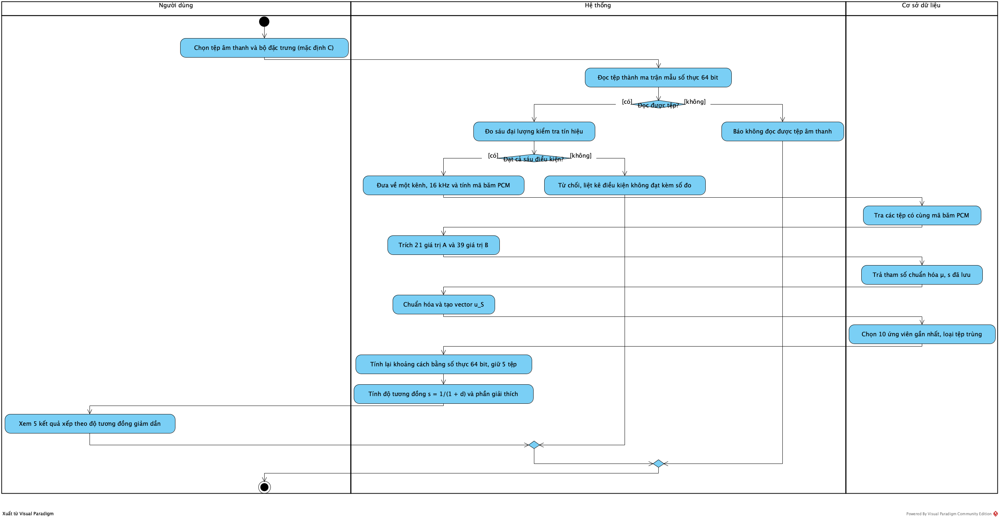

### Cách tìm 5 tệp gần nhất {#sec:cachtim}

Bước 8 có thể thực hiện theo ba cách cho cùng một kết quả:
- **pgvector** (mặc định): PostgreSQL thực hiện câu lệnh SQL ở Mục @sec:xaydung.
- **Cây k-d**: chương trình dựng một cây k-d trong bộ nhớ cho mỗi bộ đặc trưng. Ở mỗi nút, chiều chia là chiều có độ trải lớn nhất trong nhánh, điểm chia là trung vị theo chiều đó. Khi tìm, nhánh bên kia chỉ được xét nếu khoảng cách từ truy vấn đến siêu phẳng chia nhỏ hơn khoảng cách đến láng giềng thứ 5 đang giữ.
- **Vét cạn**: tính khoảng cách đến mọi tệp rồi sắp xếp; dùng để kiểm chứng hai cách trên.
Bảng @tab:cachtim so sánh các cách trên 655 truy vấn bỏ-một-ra. Cây k-d bỏ qua được khoảng một nửa số tệp ở bộ A (21 chiều), nhưng ở B và C vẫn phải tính khoảng cách tới khoảng 98% số tệp. Đây là hiện tượng đã biết của các cấu trúc phân hoạch không gian khi số chiều lớn: các điểm có khoảng cách xấp xỉ nhau nên hầu hết các nhánh đều không bị loại.

Chỉ mục HNSW là phương pháp tìm *xấp xỉ*. Khi bắt buộc dùng chỉ mục, 5 kết quả trùng với kết quả vét cạn ở 99,85–100% các vị trí. Với 655 dòng, bộ tối ưu truy vấn của PostgreSQL tự chọn quét tuần tự vì rẻ hơn dùng chỉ mục, nên kết quả mặc định vẫn chính xác.

Bảng: So sánh ba cách tìm 5 tệp gần nhất {#tab:cachtim}
| Bộ | Số chiều | Cây k-d: số tệp phải tính TB | Tỷ lệ so với 654 | HNSW bắt buộc: trùng vét cạn |
|---|---|---|---|---|
| A | 21 | 357,6 | 54,7% | 100,00% |
| B | 39 | 640,5 | 97,9% | 99,91% |
| C | 60 | 640,8 | 98,0% | 99,85% |

Hệ thống chọn pgvector làm cách mặc định vì phép tìm được thực hiện ngay trong hệ quản trị cơ sở dữ liệu, kết quả chính xác và có sẵn chỉ mục khi kho mở rộng. Cây k-d và vét cạn dùng để đối chiếu.

## Minh họa kết quả trung gian {#sec:minhhoa}

Mục này minh họa ba truy vấn với các tệp nằm ngoài kho, lấy từ tập Freesound One-Shot Percussive Sounds: một nhạc cụ đã có lớp trong kho, một nhạc cụ chưa có và một tệp bị từ chối. Nhãn của các tệp này lấy theo thông tin mô tả của nguồn. Các số liệu dưới đây đều dùng bộ C (mặc định).

### Truy vấn nhạc cụ đã có: một tiếng kick mới

Tệp truy vấn là một tiếng kick (mã Freesound 185294), dài 0,395 s. Mã băm PCM không trùng tệp nào trong kho.

Ở bước kiểm tra tín hiệu, thời gian có tiếng 0,170 s, đỉnh $-1{,}92$ dBFS, mẫu đầu bằng 0,6% đỉnh và RMS khối cuối bằng 0,2% đỉnh. Không có mẫu nào chạm $|x|\ge0{,}999$. Tệp đạt cả sáu điều kiện ở Bảng @tab:kiemtra.

Ở bước trích đặc trưng và chuẩn hóa, Bảng @tab:vd_dactrung trích 8 trong 60 thuộc tính: giá trị gốc $x$, tham số $\mu, s$ đọc từ cơ sở dữ liệu, giá trị chuẩn hóa $z$ và thành phần tương ứng của $u_C$ ($z/\sqrt{42}$ với A, $z/\sqrt{78}$ với B). Tệp có trọng tâm phổ 72 Hz và 99,9% năng lượng dưới 500 Hz, đúng đặc điểm của kick ở Bảng 5. Hình @fig:hoso vẽ $z$ của cả 60 chiều.

Bảng: Giá trị trung gian của truy vấn kick {#tab:vd_dactrung}
| Chiều | Thuộc tính | $x$ | $\mu$ | Độ tương đồng *s* | $z$ (truy vấn) | $z$ (hạng 1) | $(\Delta u)^2$ (hạng 1) |
|---|---|---|---|---|---|---|---|
| A1 | Thời gian có tín hiệu (log) | 0,157 | 0,476 | 0,459 | $-0{,}695$ | $-0{,}658$ | 0,00003 |
| A3 | Hệ số đỉnh (dB) | 12,442 | 15,712 | 3,820 | $-0{,}856$ | $-0{,}333$ | 0,00652 |
| A6 | TB trọng tâm phổ (Hz) | 72,2 | 1.530,6 | 1.698,3 | $-0{,}859$ | $-0{,}837$ | 0,00001 |
| A12 | TB độ phẳng phổ | 0,000002 | 0,0844 | 0,1230 | $-0{,}686$ | $-0{,}683$ | 0,00000 |
| A18 | TB tỷ lệ năng lượng dưới 500 Hz | 0,9993 | 0,5348 | 0,4164 | 1,116 | 1,112 | 0,00000 |
| A20 | TB thông lượng phổ | 0,282 | 0,238 | 0,132 | 0,334 | 0,624 | 0,00199 |
| B1 | TB MFCC 1 | 37,026 | 9,663 | 12,781 | 2,141 | 1,004 | 0,01657 |
| B2 | TB MFCC 2 | 7,652 | 2,563 | 7,077 | 0,719 | 0,592 | 0,00021 |

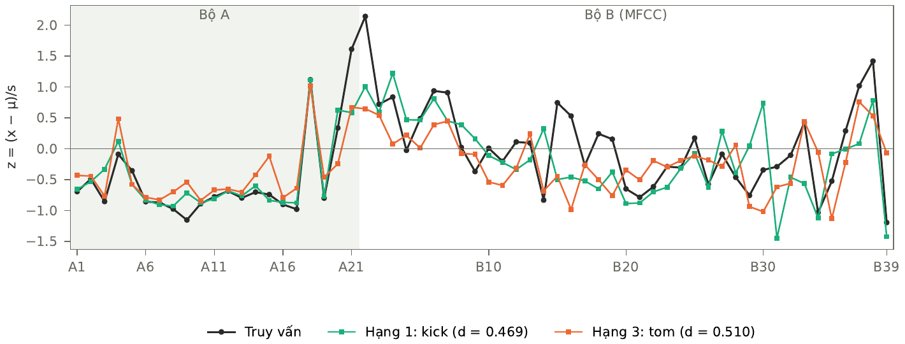

Ở bước tìm kiếm, sau khi PostgreSQL trả về các ứng viên, chương trình tính lại khoảng cách và giữ 5 tệp gần nhất (Bảng @tab:vd_ketqua).

Bảng: Kết quả truy vấn kick {#tab:vd_ketqua}
| Hạng | Mã tệp | Nguồn | Nhãn | $d_A$ | $d_B$ | $d_C$ | $s=1/(1+d_C)$ |
|---|---|---|---|---|---|---|---|
| 1 | 248 | Freesound 35656 | kick | 0,2875 | 0,5971 | 0,4686 | 0,6809 |
| 2 | 256 | Freesound 88627 | kick | 0,3123 | 0,6397 | 0,5034 | 0,6652 |
| 3 | 573 | Freesound 33169 | tom | 0,3702 | 0,6189 | 0,5099 | 0,6623 |
| 4 | 332 | Freesound 35650 | kick | 0,2396 | 0,7125 | 0,5315 | 0,6529 |
| 5 | 270 | Freesound 35664 | kick | 0,3604 | 0,6770 | 0,5423 | 0,6484 |

Độ tương đồng của kết quả hạng 1 được tính như sau. Cộng $(\Delta u)^2$ trên 21 chiều A được $0{,}04133=\tfrac12d_A^2$, trên 39 chiều B được $0{,}17829=\tfrac12d_B^2$. Do đó

$$d_C=\sqrt{\tfrac12\cdot0{,}2875^2+\tfrac12\cdot0{,}5971^2}=\sqrt{0{,}04133+0{,}17829}=0{,}4686,\qquad s=\frac{1}{1+0{,}4686}=0{,}6809.$$

Chiều đóng góp nhiều nhất vào $d_C^2$ là ĐLC thông lượng phổ (A21, 0,0250), tiếp theo là ĐLC MFCC 2 (B15, 0,0198). Phần giải thích của hệ thống so sánh $|\Delta z|$ trên bộ A: hai tệp gần như trùng nhau ở tỷ lệ năng lượng dưới 500 Hz, độ phẳng phổ và tần số cắt ($|\Delta z|<0{,}02$), và khác nhau nhiều nhất ở ĐLC thông lượng phổ ($1{,}03\sigma$) và hệ số đỉnh ($0{,}52\sigma$).

Bốn trong năm kết quả là kick; kết quả hạng 3 là tom, có $d_A$ và $d_B$ đều gần kết quả hạng 2. Kết quả này khớp với nhận xét ở Mục 11.3: kick và tom cùng là trống màng rung có năng lượng dồn ở dải thấp. Hình @fig:vd_pho cho thấy cả năm kết quả đều có khởi âm ngắn và năng lượng tập trung dưới 1 kHz như truy vấn.

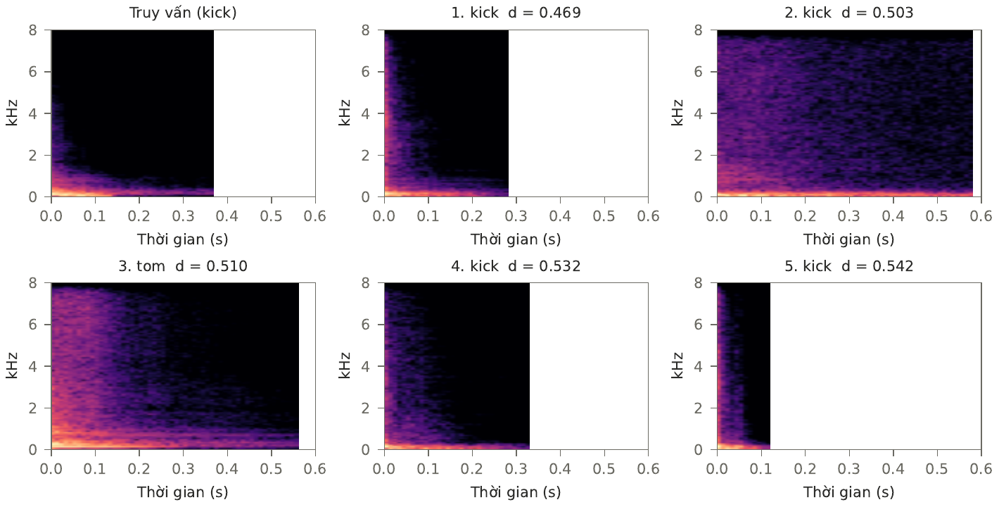

### Truy vấn nhạc cụ chưa có trong kho: djembe

Djembe là trống màng rung không thuộc 13 lớp của kho. Tệp truy vấn (mã Freesound 54015) dài 0,255 s, đạt cả sáu điều kiện kiểm tra tín hiệu. Hệ thống trả về bốn tom và một conga, đều là trống màng rung (Bảng @tab:vd_ngoai, Hình @fig:vd_ngoai).

Bảng: Kết quả truy vấn djembe {#tab:vd_ngoai}
| Hạng | Mã tệp | Nguồn | Nhãn | $d_A$ | $d_B$ | $d_C$ | Độ tương đồng *s* |
|---|---|---|---|---|---|---|---|
| 1 | 583 | Freesound 193508 | tom | 0,4524 | 1,0096 | 0,7823 | 0,5611 |
| 2 | 630 | Freesound 33174 | tom | 0,4938 | 1,0509 | 0,8210 | 0,5491 |
| 3 | 45 | Freesound 455509 | conga | 0,4293 | 1,0838 | 0,8243 | 0,5482 |
| 4 | 619 | Freesound 16318 | tom | 0,4183 | 1,0988 | 0,8313 | 0,5460 |
| 5 | 566 | Freesound 171235 | tom | 0,4814 | 1,0846 | 0,8391 | 0,5437 |

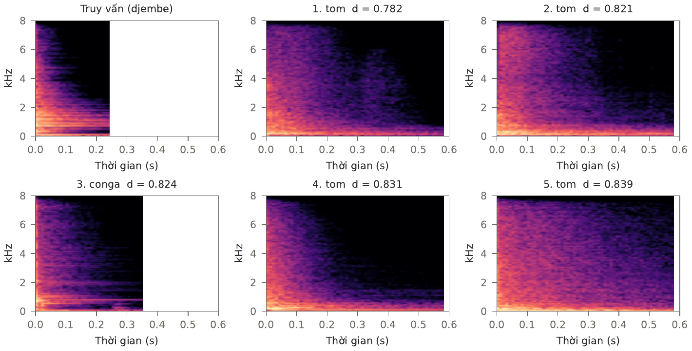

Khoảng cách $d_C$ của các kết quả (0,78–0,84) lớn hơn hẳn so với truy vấn kick (0,47–0,54), chủ yếu do $d_B$: hình dạng bao phổ của djembe khác các trống trong kho. Độ tương đồng vì vậy thấp hơn (0,54–0,56). Phần giải thích cho thấy kết quả hạng 1 gần truy vấn về độ phẳng phổ và tần số cắt, nhưng khác ở tỷ lệ năng lượng dưới 500 Hz ($1{,}05\sigma$): djembe có 48,6% năng lượng dưới 500 Hz, so với khoảng 92% của tom này.

### Truy vấn bị từ chối và truy vấn trùng kho

Một tiếng maracas (mã Freesound 9697) chỉ dài 0,036 s, phần có tiếng 0,030 s. Hệ thống từ chối với thông báo: “Không đạt điều kiện chất lượng (Mục 2): dài 0,036 s $<$ 0,1 s; phần có tiếng 0,030 s $<$ 0,05 s”. Khi truy vấn là một tệp trong kho, khối M6 tìm được mã tệp có cùng mã băm PCM và loại tệp đó; 5 kết quả là 5 tệp khác gần nhất.

## Đánh giá kết quả {#sec:danhgia}

### Phương pháp đánh giá

Đề bài yêu cầu sắp xếp theo độ tương đồng nội dung, nhưng bộ dữ liệu không có nhãn đánh giá tương đồng do người nghe gán. Vì vậy nhóm dùng *nhãn nhạc cụ* làm tiêu chí gián tiếp: một kết quả được coi là phù hợp khi cùng nhãn với truy vấn. Các chỉ số gồm:
- **P@5:** tỷ lệ kết quả cùng nhãn trong 5 kết quả;
- **Hạng 1 đúng:** kết quả đầu tiên cùng nhãn;
- **Bỏ phiếu:** nhãn xuất hiện nhiều nhất trong 5 kết quả trùng nhãn truy vấn.
Mỗi chỉ số được tính theo hai cách: trung bình trên mọi truy vấn (TV) và trung bình đều trên 13 lớp (Lớp), để lớp nhỏ không bị kick, snare lấn át.

Các phép đánh giá được thực hiện trên kho 655 tệp:
1. **Bỏ-một-ra:** lần lượt dùng từng tệp làm truy vấn, tìm trong 654 tệp còn lại.
1. **Chia theo nhóm bản thu:** 136 nhóm bản thu được chia vào 5 phần, mỗi phần 131 tệp. Tệp của một phần làm truy vấn, tìm trong 4 phần còn lại; $\mu_j, s_j$ chỉ tính trên 4 phần đó. Truy vấn và kho không bao giờ cùng nhóm bản thu. 16 truy vấn agogo bị bỏ vì cả lớp nằm trong một nhóm, nên còn 639 truy vấn.
1. **Độ bền:** truy vấn là bản biến đổi của từng tệp trong kho; kiểm tra bản gốc có được tìm lại hay không.
1. **Nhạc cụ ngoài kho:** mô tả nhãn của các kết quả khi truy vấn là nhạc cụ chưa có.
1. **Tính đúng đắn và thời gian.**

### Kết quả theo bộ đặc trưng

Bảng: Kết quả tìm kiếm của ba bộ đặc trưng {#tab:ketqua}
| Đánh giá | Bộ | P@5 (TV) | P@5 (Lớp) | Hạng 1 đúng (TV) | Hạng 1 đúng (Lớp) | Bỏ phiếu (TV) | Bỏ phiếu (Lớp) |
|---|---|---|---|---|---|---|---|
| Bỏ-một-ra | A | 0,799 | 0,674 | 0,863 | 0,805 | 0,843 | 0,717 |
| (655 truy vấn) | B | 0,730 | 0,622 | 0,815 | 0,766 | 0,795 | 0,670 |
|  | C | **0,832** | **0,741** | **0,896** | **0,869** | **0,866** | **0,778** |
| Theo nhóm bản thu | A | 0,621 | 0,446 | 0,684 | 0,562 | 0,656 | 0,441 |
| (639 truy vấn) | B | 0,571 | 0,424 | 0,649 | 0,560 | 0,610 | 0,461 |
|  | C | **0,666** | **0,521** | **0,728** | **0,654** | **0,695** | **0,535** |

Bộ C đạt cao nhất ở mọi chỉ số của cả hai cách đánh giá (Bảng @tab:ketqua). Ghép MFCC vào A làm $Q$ giảm (Bảng 7) nhưng làm P@5 tăng. $Q$ đo khoảng cách trung bình trên toàn bộ các cặp tệp, còn tìm kiếm chỉ xét 5 láng giềng gần nhất. Thông tin bao phổ của B giúp phân biệt các tệp ở gần nhau, dù trung bình toàn cục kém tách hơn.

Các chỉ số khi chia theo nhóm bản thu thấp hơn cách bỏ-một-ra khoảng 0,17 điểm P@5. Trong bỏ-một-ra, kho thường còn các tệp khác của cùng người tải lên hoặc cùng bộ trống với truy vấn; khi tách theo nhóm, hệ thống phải tìm tệp cùng nhạc cụ từ nguồn thu khác, nên chỉ số này phản ánh sát hơn trường hợp truy vấn là một bản thu mới.

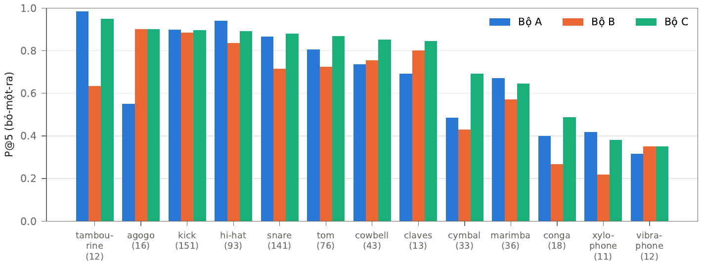

Hình @fig:p5lop cho thấy tambourine, agogo, kick, hi-hat, snare đạt P@5 từ 0,88 trở lên với bộ C. Các lớp thấp nhất trùng với những cặp gần nhau đã nêu ở Phần I:
- conga (0,49): 41 trong 90 vị trí kết quả là tom; conga/tom có khoảng cách tâm nhỏ nhất ở Bảng 9;
- vibraphone (0,35): 36 trong 60 vị trí là marimba; marimba (0,64) nhầm chủ yếu sang kick và vibraphone, do năng lượng tập trung ở dải thấp (Bảng 5);
- xylophone (0,38): nhầm sang cowbell, kick, snare; lớp chỉ có 11 tệp;
- cymbal (0,69): nhầm sang snare, cùng nhóm phổ phân tán.
Theo nguồn, P@5 của bộ C là 0,917 với IDMT, 0,841 với Freesound và 0,571 với Iowa; các lớp của Iowa (marimba, vibraphone) chịu ảnh hưởng của nốt được chơi như đã nêu ở Mục 11.3.

### Ma trận nhầm lẫn {#sec:nhamlan}

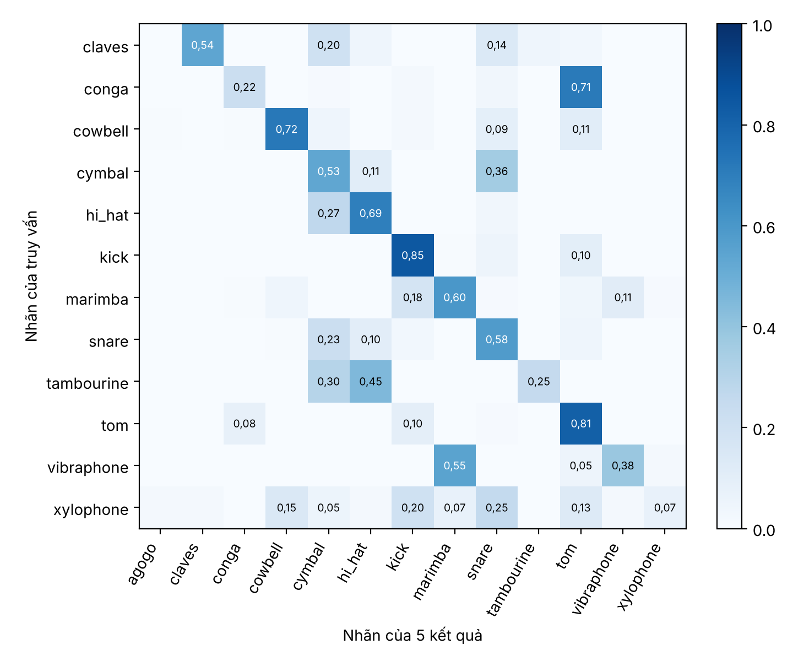

Hình @fig:nhamlan cho biết các kết quả sai rơi vào lớp nào khi truy vấn đến từ một nguồn thu khác. Các cặp nhầm lớn nhất là conga → tom (0,71), vibraphone → marimba (0,55), tambourine → hi-hat (0,45) và cymbal → snare (0,36). Các cặp này đều cùng họ hoặc cùng nhóm phổ phân tán, khớp với các cặp có khoảng cách tâm nhỏ đã nêu ở Phần I. Tambourine đạt P@5 cao khi bỏ-một-ra nhưng chỉ 0,25 khi tách nhóm bản thu, vì 12 tệp của lớp này đến từ ít nguồn: bỏ-một-ra chủ yếu tìm lại tệp cùng buổi thu.

### Lựa chọn bộ đặc trưng mặc định {#sec:chonbo}

Mục 10.3 chọn A làm bộ mặc định ban đầu dựa trên $Q$ và để kết quả tìm kiếm quyết định bộ cuối cùng. Theo Bảng @tab:ketqua, C có P@5, tỷ lệ hạng 1 đúng và tỷ lệ bỏ phiếu đúng cao nhất ở cả bỏ-một-ra lẫn chia theo nhóm bản thu, tính theo truy vấn và theo lớp, nên hệ thống dùng bộ C làm mặc định; A và B vẫn chọn được khi truy vấn. B nhạy với nén MP3 (Mục @sec:doben), nên với truy vấn MP3 bộ A tìm lại bản gốc tốt hơn C.

### Độ bền với biến đổi tín hiệu {#sec:doben}

Mỗi tệp trong kho được biến đổi rồi dùng làm truy vấn; bản gốc vẫn ở trong kho. Bảng @tab:doben cho tỷ lệ bản gốc xuất hiện ở hạng 1 và P@5 tính trên 5 kết quả còn lại sau khi bỏ bản gốc.

Bảng: Độ bền với biến đổi tín hiệu {#tab:doben}
| Biến đổi | Số truy vấn | Hạng 1 (A) | Hạng 1 (B) | Hạng 1 (C) | P@5 (A) | P@5 (B) | P@5 (C) |
|---|---|---|---|---|---|---|---|
| Stereo, 44,1 kHz | 655 | 0,994 | 0,998 | 0,997 | 0,795 | 0,729 | 0,832 |
| Giảm âm lượng 20 dB | 624 | 0,997 | 0,973 | 0,990 | 0,802 | 0,736 | 0,840 |
| Nén MP3, 44,1 kHz | 655 | 0,973 | 0,792 | 0,849 | 0,794 | 0,697 | 0,809 |
| Thêm nhiễu trắng, SNR 30 dB | 654 | 0,528 | 0,581 | 0,642 | 0,601 | 0,623 | 0,683 |

- **Stereo 44,1 kHz:** sau khi đưa về mono 16 kHz, bản gốc gần như luôn ở hạng 1.
- **Giảm âm lượng:** đặc trưng không phụ thuộc độ to nhờ chuẩn hóa đỉnh (Mục 6). 31 truy vấn bị từ chối vì tệp gốc có đỉnh dưới $-20$ dBFS, nên sau khi giảm 20 dB thì dưới ngưỡng $-40$ dBFS của Mục 2.
- **Nén MP3:** bộ A ít bị ảnh hưởng; MFCC (B) nhạy với phần phổ bị bộ mã hóa thay đổi.
- **Nhiễu trắng:** ảnh hưởng mạnh nhất, vì nhiễu làm tăng độ phẳng phổ, ZCR và năng lượng ở các đoạn im lặng, đúng những thuộc tính có $J_j$ cao ở Bảng 10. Một truy vấn bị từ chối vì mẫu đầu vượt 10% đỉnh.

### Truy vấn bằng nhạc cụ ngoài kho {#sec:ngoaikho}

Nhóm dùng 73 tệp thuộc 12 loại nhạc cụ không có trong kho, lấy từ cùng tập Freesound. Nhãn của các tệp lấy theo thông tin mô tả của nguồn nên chỉ mang tính tham khảo. 4 tệp (một cabasa, hai maracas, một shaker) bị từ chối vì dài dưới 0,1 s, còn 69 tệp đều nhận đủ 5 kết quả. Không có đáp án “đúng” cho các truy vấn này, nên Bảng @tab:ngoaikho chỉ mô tả kết quả: nhãn thường gặp nhất và tỷ lệ kết quả cùng họ nhạc cụ theo Bảng 1, không phải số đo độ chính xác.

Bảng: Kết quả với nhạc cụ ngoài kho {#tab:ngoaikho}
| Nhạc cụ | Số tệp | Họ | Nhãn kết quả thường gặp (bộ C) | Cùng họ (A) | Cùng họ (B) | Cùng họ (C) |
|---|---|---|---|---|---|---|
| djembe | 24 | màng rung | tom 60, kick 41, cowbell 9, conga 5 | 0,76 | 0,85 | 0,92 |
| bongo | 7 | màng rung | conga 11, snare 11, tom 10 | 0,71 | 0,71 | 0,97 |
| tabla | 1 | màng rung | tom 3, kick 2 | 1,00 | 1,00 | 1,00 |
| gong | 8 | kim loại | cowbell 15, snare 8, tom 7, cymbal 5 | 0,47 | 0,68 | 0,50 |
| triangle | 2 | kim loại | cymbal 5, hi-hat 4, tambourine 1 | 0,70 | 0,80 | 1,00 |
| castanets | 15 | gỗ | snare 44, claves 20, cymbal 10 | 0,13 | 0,08 | 0,27 |
| woodblock | 4 | gỗ | snare 8, kick 4, tom 3, cowbell 2 | 0,25 | 0,00 | 0,05 |
| cajon | 3 | gỗ | tom 8, kick 5 | 0,00 | 0,00 | 0,00 |
| maracas, shaker, vibraslap | 5 | – | hi-hat 9, snare 9, cymbal 5, tambourine 2 | – | – | – |

Các trống màng rung (djembe, bongo, tabla) được ghép với tom, conga, kick; triangle được ghép với cymbal và hi-hat. Các nhạc cụ gỗ ít khi nhận kết quả cùng họ vì họ này trong kho chỉ có claves (13 tệp). Castanets vẫn nhận claves ở 20 trong 75 vị trí. Cajon là hộp gỗ nhưng được chơi như trống trầm, nên kết quả là tom và kick; các nhạc cụ lắc nhận các lớp phổ phân tán như hi-hat, snare.

**Khoảng cách tới kết quả gần nhất.** Hệ thống luôn trả 5 tệp, kể cả khi nhạc cụ chưa có trong kho. Để xem khoảng cách có cho biết điều đó hay không, nhóm so sánh khoảng cách *d*₁ tới kết quả hạng 1 của hai loại truy vấn: 655 tệp trong kho (mỗi truy vấn bỏ ra cả nhóm bản thu của nó, để giống một bản thu mới) và 69 tệp nhạc cụ ngoài kho.

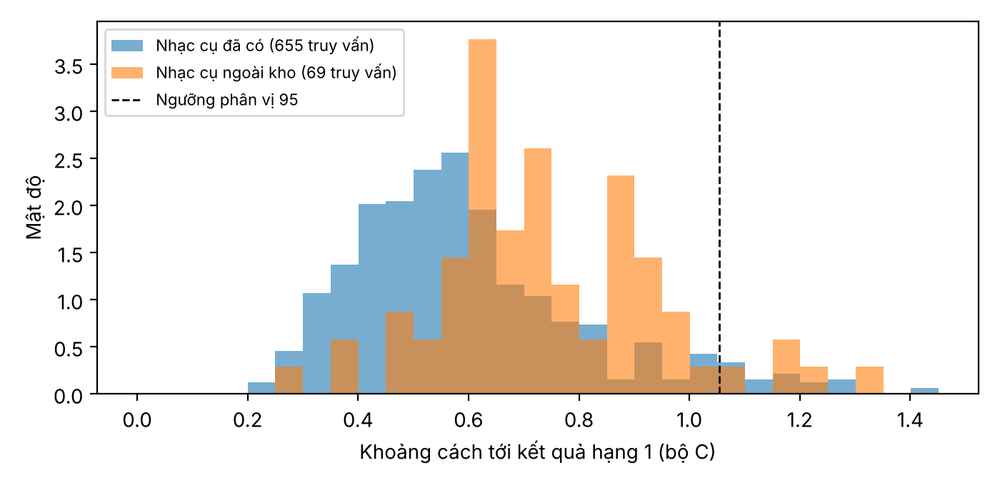

Với bộ C, trung vị *d*₁ là 0,558 với nhạc cụ đã có và 0,707 với nhạc cụ ngoài kho (Hình @fig:phanbo). Nếu đặt ngưỡng cảnh báo ở mức mà 95% truy vấn của nhạc cụ đã có không vượt quá (*d*₁ > 1,054), chỉ 7% truy vấn ngoài kho bị cảnh báo. Hai phân bố chồng lên nhau nhiều, nên khoảng cách chỉ là dấu hiệu tham khảo: hệ thống không tự kết luận được “nhạc cụ này chưa có trong kho”. Điều này phù hợp với mục tiêu của đề bài là tìm tệp *tương đồng*, không phải phân loại nhạc cụ.

### Kiểm thử thủ công trên giao diện {#sec:kiemthugd}

Các chỉ số ở trên chỉ dựa vào nhãn nhạc cụ. Để biết kết quả có thật sự nghe giống truy vấn hay không, nhóm tự chạy truy vấn trên giao diện web rồi nghe lại. Nhóm dùng 9 tệp âm thanh tải từ Freesound, đều là một cú đánh đơn và đều không nằm trong kho 655 tệp:
- **5 tệp của nhạc cụ chưa có trong kho:** một tiếng djembe (trống tay châu Phi, 0,21 s), một tiếng triangle (thanh kim loại uốn hình tam giác, 0,37 s), một tiếng castanets (hai mảnh gỗ gõ vào nhau, 0,23 s), một tiếng gong (cồng kim loại, 0,11 s) và một tiếng bongo (cặp trống tay nhỏ, 0,37 s);
- **4 bản thu mới của nhạc cụ đã có trong kho:** snare (0,23 s), xylophone (0,68 s), kick (0,39 s) và hi-hat (0,44 s).

Mỗi tệp được tải lên giao diện và tìm lần lượt với bộ A, B và C, tổng cộng 27 lần tìm. Với mỗi lần tìm, nhóm nghe tệp truy vấn rồi nghe từng kết quả, so sánh chất liệu âm (gỗ, kim loại, màng trống), khởi âm, độ ngân và cao độ. Kết quả hiển thị trên giao diện trùng hoàn toàn (tệp, thứ tự và độ tương đồng) với kết quả tìm vét cạn của chương trình đánh giá. Bảng @tab:kiemthugd ghi nhãn của 5 kết quả, khoảng độ tương đồng *s* và nhận xét của nhóm.

Bảng: Kết quả kiểm thử thủ công với ba bộ đặc trưng {#tab:kiemthugd}
| Truy vấn | Bộ | Nhãn 5 kết quả (hạng 1 → 5) | Độ tương đồng *s* | Nhận xét khi nghe |
|---|---|---|---|---|
| djembe (chưa có) | A | conga, cowbell, cowbell, snare, tom | 0,73–0,78 | Cả 5 kết quả có khởi âm hơi giống truy vấn. |
|  | B | kick, snare, cymbal, kick, hi-hat | 0,46–0,47 | Khá tệ: chất liệu lệch hẳn, có một tệp dài 9,6 s. |
|  | C | cowbell, conga, cowbell, cowbell, kick | 0,50–0,52 | Khởi âm khá giống, chất liệu hơi giống; riêng hạng 5 (kick) khác hẳn 4 tệp trước. |
| triangle (chưa có) | A | hi-hat, claves, tambourine, hi-hat, claves | 0,68–0,73 | Khởi âm gần giống nhưng cao độ mỗi tệp một khác; chất liệu như gõ vào kim loại hoặc thanh gỗ. |
|  | B | hi-hat, cymbal, hi-hat, hi-hat, hi-hat | 0,53–0,57 | Trả về các tệp dài; hạng 1 tốt nhất, chất liệu và khởi âm hơi giống. |
|  | C | cymbal, cymbal, tambourine, cymbal, cymbal | 0,56–0,57 | Cao độ cao hơn truy vấn, khởi âm hơi giống; khá giống kết quả của bộ A. |
| castanets (chưa có) | A | snare, snare, cowbell, cowbell, cowbell | 0,70–0,73 | Giống khởi âm, hơi giống cao độ. |
|  | B | claves, snare, snare, snare, cymbal | 0,59–0,60 | Giống khởi âm; hạng 1 (claves) nghe như hai thanh gỗ chạm nhau, gần giống truy vấn; các tệp còn lại là âm kim loại. |
|  | C | claves, snare, claves, snare, claves | 0,59–0,61 | Tốt nhất trong ba bộ: các kết quả nghe như gõ vào gỗ; các tệp snare cao hơn và hơi khác chất liệu. |
| gong (chưa có) | A | tom, tom, tom, conga, conga | 0,85–0,92 | Giống khởi âm và cao độ. |
|  | B | cowbell, snare, hi-hat, snare, hi-hat | 0,45–0,47 | Kém hơn bộ A. |
|  | C | cowbell, snare, conga, conga, cowbell | 0,50–0,51 | Không tốt bằng bộ A. |
| bongo (chưa có) | A | tom, tom, cowbell, cowbell, cowbell | 0,73–0,78 | Hai tệp đầu khác truy vấn về khởi âm và độ ngân. |
|  | B | tom, snare, snare, snare, snare | 0,52–0,54 | Không ghi nhận xét. |
|  | C | tom, conga, tom, tom, snare | 0,54–0,56 | Hạng 2 (conga) gần như thay thế được truy vấn. |
| snare (đã có) | A | snare × 5 | 0,78–0,86 | Ba kết quả đầu gần giống, hạng 1 và 3 gần như thay thế được; hạng 4–5 ngân dài hơn, cao độ cao hơn một chút. |
|  | B | snare × 4, tom | 0,60–0,61 | Cao độ cao hơn nên nghe không giống. |
|  | C | snare × 5 | 0,63–0,65 | Không tốt bằng bộ A, chỉ nhỉnh hơn bộ B một chút. |
| xylophone (đã có) | A | cowbell, agogo, cowbell, xylophone, xylophone | 0,65–0,69 | Kết quả agogo (hạng 2) gần giống truy vấn nhất. |
|  | B | xylophone × 3, snare, kick | 0,44–0,49 | Ba tệp đầu khá tốt, hai tệp sau khác hẳn. |
|  | C | xylophone × 3, cowbell, cymbal | 0,49–0,54 | Hạng 1 và 3 giống chất liệu nhất; hai tệp cuối khác hẳn. |
| kick (đã có) | A | kick × 5 | 0,82–0,86 | Cả 5 kết quả đều là âm trầm. |
|  | B | kick, kick, tom, tom, tom | 0,62–0,63 | Cao độ khác hẳn truy vấn. |
|  | C | kick, kick, tom, kick, kick | 0,65–0,68 | Nghe tốt hơn bộ A một chút. |
| hi-hat (đã có) | A | hi-hat × 4, cymbal | 0,78–0,88 | Hạng 1–2 thay thế được truy vấn, hạng 3–4 chỉ hơi giống, hạng 5 (cymbal) khác hẳn. |
|  | B | hi-hat × 5 | 0,63–0,72 | Hạng 1 thay thế được; hạng 3 gần giống nhưng khởi âm nhẹ hơn, cao độ hơi khác. |
|  | C | hi-hat × 5 | 0,67–0,77 | Hai kết quả đầu thay thế được, ba kết quả còn lại yếu hơn. |

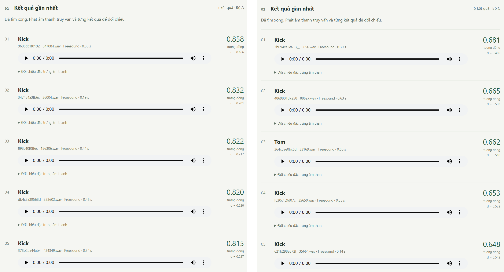

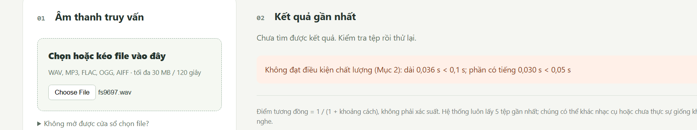

Từ Bảng @tab:kiemthugd, nhóm rút ra:
- **Đúng nhãn chưa chắc đã nghe giống hơn.** Với kick, bộ A trả về 5/5 kick với độ tương đồng cao nhất (0,82–0,86), nhưng nhóm nghe thấy kết quả của bộ C (4/5 kick, hạng 3 là tom) giống hơn một chút (Hình @fig:kickAC). Với snare, A và C đều đúng 5/5 nhưng khi nghe thì A tốt hơn rõ. Ngược lại, có kết quả khác nhãn mà nghe vẫn giống: agogo với truy vấn xylophone ở bộ A, claves với truy vấn castanets. Đây là lý do P@5 theo nhãn ở Bảng @tab:ketqua chỉ là thước đo gián tiếp.
- **Bộ C tốt nhất hoặc ngang tốt nhất ở phần lớn truy vấn** (castanets, bongo, kick, hi-hat, xylophone, triangle). Bộ A tốt hơn rõ ở gong và snare, có thể vì A chứa các thuộc tính về thời gian như khởi âm và độ ngân. Điều này khớp với việc chọn C làm bộ mặc định nhưng vẫn cho phép người dùng chọn A.
- **Bộ B kém nhất khi nghe.** Trong 6/9 truy vấn, bộ B trả về ít nhất một bản thu IDMT dài 8–18 s, trong khi truy vấn chỉ dài 0,1–0,7 s. B chỉ gồm trung bình và độ lệch chuẩn của MFCC, không có thông tin về độ dài và đường bao năng lượng, nên không phân biệt được một cú đánh đơn với một đoạn chơi dài có cùng màu âm. B chỉ cho kết quả tốt ở hạng đầu của hi-hat, triangle, castanets và ba hạng đầu của xylophone.
- **Với nhạc cụ chưa có trong kho**, hệ thống vẫn trả về các âm có kiểu đánh và khởi âm tương tự: castanets được ghép với claves (nhạc cụ gỗ duy nhất trong kho), bongo được ghép với conga và tom, triangle được ghép với các âm kim loại. Với gong và djembe, khi kho không có âm thật sự gần thì kết quả chỉ giống một phần.
- **Độ tương đồng chỉ so sánh được trong cùng một bộ.** Độ tương đồng *s* của bộ A luôn cao hơn B và C cho cùng truy vấn, nhưng điều đó không có nghĩa A nghe giống hơn; mỗi bộ có số chiều và cách chuẩn hóa riêng.
- **Kiểm tra đầu vào:** một tiếng maracas chỉ dài 0,036 s bị từ chối kèm lý do cụ thể (Hình @fig:tuchoi), đúng điều kiện chất lượng của Mục 2.

Nhận xét khi nghe là đánh giá chủ quan của nhóm trên 9 truy vấn, dùng để bổ sung cho các số đo tự động chứ không thay thế chúng.

### Tính đúng đắn và thời gian xử lý {#sec:dungdan}

- Ba cách tìm (pgvector, cây k-d, vét cạn) cho kết quả trùng nhau ở 655/655 truy vấn bỏ-một-ra của cả ba bộ, cả thứ tự lẫn khoảng cách.
- 17 phép kiểm thử tự động đều đạt. Các phép kiểm thử gồm: cây k-d trùng vét cạn khi có điểm trùng nhau; vector trong PostgreSQL khớp giá trị 64 bit; truy vấn trùng kho bị loại; bản stereo 44,1 kHz tìm lại bản gốc; tệp im lặng, hỏng, quá nhỏ, mất khởi âm, cắt đuôi hoặc cắt đỉnh bị từ chối; ràng buộc `CHECK` hoạt động; giao diện web xử lý đúng tệp tải lên và yêu cầu sai.
Trên máy tính của nhóm, trung vị thời gian trên 100 truy vấn là khoảng 1 ms cho đọc tệp, kiểm tra và trích đặc trưng. Phần tìm 5 tệp gần nhất với bộ C mất khoảng 1–2 ms qua PostgreSQL, 1,2 ms với cây k-d và 0,1 ms với vét cạn bằng NumPy. Thời gian qua PostgreSQL chủ yếu là chi phí gửi nhận câu lệnh.

### Nhận xét chung

Hệ thống nhận tệp mới ở nhiều định dạng và trả đúng 5 tệp xếp theo độ tương đồng giảm dần, kể cả với nhạc cụ chưa có trong kho. Với bộ C, trung bình 4,2/5 kết quả cùng nhạc cụ với truy vấn (bỏ-một-ra) và 3,3/5 khi truy vấn khác nhóm bản thu. Kết quả kém nhất ở các cặp lớp gần nhau (conga/tom, marimba/vibraphone) và các lớp ít tệp. P@5 dựa trên nhãn nhạc cụ; kiểm thử nghe trên 9 truy vấn (Mục @sec:kiemthugd) cho thấy kết quả đúng nhãn chưa chắc nghe giống hơn, bộ C và A cho kết quả nghe tốt hơn bộ B, và bộ B hay trả về các bản thu dài.

# Kết luận {-}

Nhóm đã thực hiện Yêu cầu 3 và 4 của đề tài:
1. Công cụ trích rút đặc trưng dùng chung một mã nguồn cho kho và truy vấn. Hệ cơ sở dữ liệu PostgreSQL + pgvector gồm sáu bảng, có ràng buộc theo đúng các điều kiện chất lượng; giá trị lưu trữ trùng bảng đặc trưng của báo cáo Yêu cầu 1–2 (Phần III).
1. Hệ thống tìm 5 tệp tương đồng nhất cho tệp âm thanh mới, kể cả nhạc cụ chưa có trong kho. Hệ thống được mô tả bằng sơ đồ khối, minh họa các giá trị trung gian và được đánh giá bằng nhiều phép thử. Bộ C đạt P@5 bằng 0,832 khi bỏ-một-ra và 0,666 khi tách theo nhóm bản thu, cao nhất trong ba bộ, nên được chọn làm mặc định (Phần IV).
Cơ sở dữ liệu và các kết quả đánh giá đều có thể tạo lại từ mã nguồn kèm theo.

# Phụ lục: danh sách thuộc tính của các bộ đặc trưng {-}

Bảng @tab:thuoctinh liệt kê thứ tự các chiều dùng trong vector và trong cơ sở dữ liệu. “TB” và “ĐLC” lần lượt là trung bình và độ lệch chuẩn trên khung hợp lệ. Trong A, mỗi cặp thuộc tính theo khung được xếp TB trước, ĐLC sau. Cách ghép và trọng số của C được quy định ở Mục 10.

Bảng: Thuộc tính của bộ A và bộ B {#tab:thuoctinh}
| Chiều | Thuộc tính | Ký hiệu | Đơn vị | Định nghĩa |
|---|---|---|---|---|
| **Bộ A: 5 thuộc tính thời gian** |  |  |  |  |
| A1 | Thời gian có tín hiệu (log) | $a_1$ | – | $\ln(1+T_a)$, Mục 7 |
| A2 | Khoảng chứa 90% năng lượng (log) | $a_2$ | – | $\ln(1+D_{90})$ |
| A3 | Hệ số đỉnh | $a_3$ | dB | Đỉnh so với RMS vùng có tín hiệu |
| A4 | Tỷ lệ có tín hiệu | $a_4$ | – | $T_a/T_s$ |
| A5 | Vị trí đỉnh bao RMS | $a_5$ | – | Vị trí tương đối trong vùng có tín hiệu |
| **Bộ A: 16 thuộc tính phổ (TB và ĐLC của 8 đại lượng)** |  |  |  |  |
| A6–A7 | Trọng tâm phổ | $C$ | Hz | Mục 8 |
| A8–A9 | Độ rộng phổ | $W$ | Hz |  |
| A10–A11 | Tần số cắt 85% | $R$ | Hz |  |
| A12–A13 | Độ phẳng phổ | $F$ | – |  |
| A14–A15 | Entropy phổ | $H$ | – |  |
| A16–A17 | Tỷ lệ đổi dấu | $Z$ | – |  |
| A18–A19 | Tỷ lệ năng lượng dưới 500 Hz | $L$ | – |  |
| A20–A21 | Thông lượng phổ dương | $\Phi$ | – |  |
| **Bộ B: 39 thuộc tính MFCC** |  |  |  |  |
| B1–B13 | TB của MFCC 1 đến 13 | $c[1..13]$ | – | Mục 9 |
| B14–B26 | ĐLC của MFCC 1 đến 13 | $c[1..13]$ | – |  |
| B27–B39 | ĐLC của delta MFCC 1 đến 13 | $\Delta c[1..13]$ | – |  |


# Tài liệu tham khảo

- Bentley, J. L. (1975). Multidimensional binary search trees used for associative searching. *Communications of the ACM, 18*(9), 509–517.
- Friedman, J. H., Bentley, J. L., & Finkel, R. A. (1977). An algorithm for finding best matches in logarithmic expected time. *ACM Transactions on Mathematical Software, 3*(3), 209–226.
- Kane, A., và cộng sự. (2024). *pgvector: Open-source vector similarity search for Postgres* (Phiên bản 0.8.0) [Phần mềm]. https://github.com/pgvector/pgvector
- Malkov, Y. A., & Yashunin, D. A. (2020). Efficient and robust approximate nearest neighbor search using Hierarchical Navigable Small World graphs. *IEEE Transactions on Pattern Analysis and Machine Intelligence, 42*(4), 824–836.
- Manning, C. D., Raghavan, P., & Schütze, H. (2008). *Introduction to information retrieval* (Chương 8). Cambridge University Press.
- PostgreSQL Global Development Group. (n.d.). *PostgreSQL 17 documentation*. https://www.postgresql.org/docs/17/
- Ramires, A., Chandna, P., Favory, X., Gómez, E., & Serra, X. (2021). *Freesound one-shot percussive sounds* (Phiên bản 1.0) [Bộ dữ liệu]. Zenodo. https://doi.org/10.5281/zenodo.4687854
- Weber, R., Schek, H.-J., & Blott, S. (1998). A quantitative analysis and performance study for similarity-search methods in high-dimensional spaces. *Proceedings of the 24th VLDB Conference*, 194–205.
